<div align="center">

# Week 4: Black-Box Penetration Test and Vulnerability Assessment

### Authorized web application penetration test completed under the Networkwalks Cybersecurity Internship

**Prepared by Mulenga Chiwele** · Batch BO83 · 24 November 2026


[Overview](#overview) · [Educational Purpose](#educational-purpose) · [Executive Summary](#executive-summary) · [Findings](#findings-summary) · [Attack Chain](#attack-chain) · [Recommendations](#recommendations) · [Contact](#about-the-author)

</div>

---

## Table of Contents

- [Overview](#overview)
- [Educational Purpose](#educational-purpose)
- [Objectives](#objectives)
- [Engagement Details](#engagement-details)
- [Executive Summary](#executive-summary)
- [Milestones](#milestones)
- [Findings Summary](#findings-summary)
- [Attack Chain](#attack-chain)
- [Detailed Findings](#detailed-findings)
- [Methodology](#methodology)
- [Tools Used](#tools-used)
- [Risk Rating](#risk-rating)
- [Recommendations](#recommendations)
- [Key Takeaways](#key-takeaways)
- [Repository Structure](#repository-structure)
- [Evidence](#evidence)
- [Project Report](#project-report)
- [About the Author](#about-the-author)
- [Disclaimer](#disclaimer)
- [Copyright](#copyright)

---

## Overview

This repository documents a black-box penetration test completed as part of the [Networkwalks](https://networkwalks.com) Cybersecurity Internship. The engagement assessed the public web infrastructure of a healthcare provider over five days, from initial reconnaissance through to a written professional report.

To protect confidentiality, the client's name, domain, patient records, employee data and credentials are withheld. Findings are presented by category and severity so that the methodology and lessons remain useful without exposing any individual's information.

**Ethics statement:** The target was explicitly authorized for security testing under the Networkwalks training programme. No technique described here should be applied to any system without explicit written permission from its owner.

## Educational Purpose

This repository is published solely for educational and defensive-security learning. It is intended to show students, analysts and developers:

- How common web weaknesses are identified and why they matter.
- How a professional penetration test is planned, executed, documented and reported.
- How to write remediation advice that a development or operations team can act on.

It is not a guide for attacking systems. The techniques are described at the level needed to understand the findings, and the sensitive details that would enable misuse have been removed.

## Objectives

- Assess the public attack surface of a web application using a black-box approach.
- Identify weaknesses in authentication, access control and information disclosure.
- Recover and verify protected data without prior knowledge of the system.
- Evaluate the strength of the encryption protecting sensitive documents.
- Produce a clear, prioritized report with actionable remediation guidance.

## Engagement Details

| Item | Details |
|------|---------|
| Tester | Mulenga Chiwele |
| Engagement type | Black-box penetration test and vulnerability assessment |
| Client | Healthcare provider (name withheld) |
| Target | Public web application (domain withheld) |
| Duration | 5 days |
| Overall risk | Critical |
| Report date | 24 November 2026 |

## Executive Summary

The assessment achieved full compromise of the confidentiality objective. Starting from only the public website, the tester bypassed the patient portal's authentication, retrieved three confidential documents, defeated their encryption, and located an unauthenticated database backup containing sensitive internal records.

Two of the most serious findings require no specialist skill to exploit. An attacker using freely available tools could reproduce the core attack chain in under an hour. Immediate remediation is recommended for all critical and high-severity findings.

## Milestones

| Milestone | Objective | Status |
|:-:|-----------|:-:|
| M1 | Gain access to the web application and retrieve three confidential documents | Complete |
| M2 | Defeat the encryption protecting the retrieved documents | Complete |
| M3 | Locate sensitive internal data exposed by the system | Complete |
| M4 | Produce a professional penetration testing report | Complete |

## Findings Summary

| ID | Finding | Severity |
|:-:|---------|:-:|
| V-01 | SQL injection leading to authentication bypass in the patient portal | Critical |
| V-02 | Exposed, unauthenticated database backup containing sensitive internal records | Critical |
| V-03 | Weak, predictable passwords protecting encrypted documents | High |
| V-04 | Directory listing enabled on multiple server paths | High |
| V-05 | Sensitive internal information disclosed through document metadata | Medium |

## Attack Chain

```
robots.txt disclosure
        │
        ▼
Directory listing on exposed paths
        │
        ▼
SQL injection in portal login (V-01)
        │
        ▼
Encrypted documents retrieved
        │
        ▼
Weak passwords recovered (V-03)
        │
        ▼
Document metadata reveals backup location (V-05)
        │
        ▼
Unauthenticated database backup downloaded (V-02)
```

## Detailed Findings

### V-01: SQL Injection Leading to Authentication Bypass (Critical)

**Impact:** An attacker can log in as an existing user without knowing any valid password.

**Observation:** The patient portal login form passed user input directly into a database query. A specially crafted username caused the server to treat the password check as a comment, and the server issued a valid session.

**Remediation:** Use parameterized queries for all database access, validate input on the server, and run the application under a least-privilege database account.

### V-02: Exposed Database Backup (Critical)

**Impact:** Staff salary records, national identifiers and shareholder details were available to anyone who knew the file's location.

**Observation:** A database backup was stored in a web-accessible directory with no authentication. The file header marked it as confidential, but nothing prevented its download.

**Remediation:** Remove backups from web-accessible locations, store them in a protected area with authentication and access logging, and audit the server for other copies.

### V-03: Weak, Predictable Passwords on Encrypted Documents (High)

**Impact:** Three confidential patient documents were opened within seconds using a publicly available wordlist.

**Observation:** All three files used the same encryption scheme, so password strength was the only effective barrier. Each password appeared in widely circulated leaked-password lists.

**Remediation:** Enforce a strong password policy, prefer generated high-entropy passphrases, and avoid relying on passwords that users choose for protecting sensitive documents.

### V-04: Directory Listing Enabled (High)

**Impact:** Attackers could browse complete file inventories of several server paths, revealing backups and application source files.

**Observation:** Directory indexing was enabled on multiple paths. The same paths were listed in `robots.txt`, which helped direct the search.

**Remediation:** Disable directory indexing on all paths and return a generic error for unauthorized requests. Do not rely on `robots.txt` to conceal sensitive locations.

### V-05: Sensitive Information in Document Metadata (Medium)

**Impact:** An internal note in a file's metadata pointed directly to the database backup, linking this finding to the critical V-02 exposure.

**Observation:** Document properties contained operational comments that were never visible in the document body.

**Remediation:** Remove metadata before publishing or storing documents, and train staff to keep internal notes out of file properties.

## Methodology

1. **Reconnaissance:** Reviewed publicly available files such as `robots.txt` for paths intentionally hidden from search engines.
2. **Enumeration:** Checked exposed directories and reviewed the login workflow.
3. **Exploitation:** Tested the login form for injection flaws and confirmed the authentication bypass.
4. **Document analysis:** Identified the encryption scheme used on retrieved documents and assessed password strength.
5. **Password recovery:** Tested passwords against a standard public wordlist to verify the weakness.
6. **Metadata analysis:** Examined file metadata for internal references that led to further exposure.
7. **Reporting:** Documented each finding with evidence, severity and remediation steps.

## Tools Used

| Phase | Tool |
|-------|------|
| Reconnaissance | curl |
| Exploitation | curl (crafted HTTP requests) |
| Encryption analysis | qpdf |
| Hash extraction | pdf2john |
| Password recovery | pdfcrack with a standard public wordlist |
| Decryption | qpdf |
| Metadata analysis | exiftool |

## Risk Rating

| Severity | Meaning |
|----------|---------|
| Critical | Exploitable with low skill, with severe impact on confidentiality |
| High | A significant weakness that materially increases risk |
| Medium | Limited direct impact, but useful to an attacker in combination with other findings |

## Recommendations

| Finding | Recommended Remediation |
|---------|-------------------------|
| V-01 SQL injection | Use parameterized queries for all database access, validate input, and apply least-privilege database accounts |
| V-02 Exposed backup | Remove backups from web-accessible directories, store them in a protected location with authentication and logging |
| V-03 Weak passwords | Enforce a strong password policy and multi-factor authentication, and use high-entropy keys with a modern encryption scheme |
| V-04 Directory listing | Disable directory indexing on all paths and return a generic error page for unauthorized requests |
| V-05 Metadata disclosure | Remove metadata before publishing or storing documents, and keep internal notes out of file properties |

**Additional recommendations:**

- Treat `robots.txt` as publicly readable. It is not an access control mechanism.
- Conduct regular penetration tests and vulnerability scans, and retest after remediation.
- Train staff in secure document handling and in the risks of metadata leakage.

## Key Takeaways

- A single input-handling flaw can bypass authentication entirely.
- Backups and internal files left in web-accessible locations represent a common and serious exposure.
- Weak passwords undermine even standard encryption.
- Metadata can leak internal details that never appear in a document's visible content.
- Security controls should be verified from an attacker's perspective rather than assumed.

## Repository Structure

The repository contains this `README.md` with the full write-up, and an `IMAG` folder with redacted evidence for each milestone:

- **Milestone 1:** Initial access and authentication bypass
- **Milestone 2:** Document encryption analysis and recovery
- **Milestone 3:** Metadata analysis and data exposure

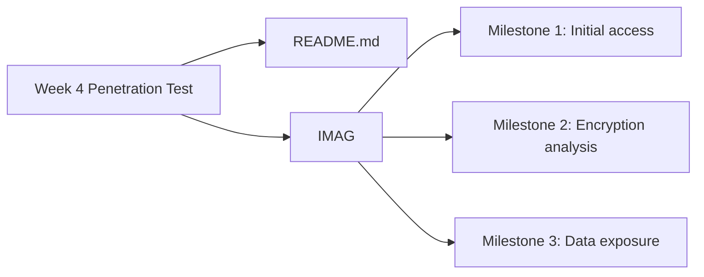

## Evidence

All screenshots are redacted to remove client identity, personal data and credentials.

<p align="center">
  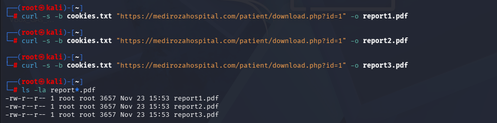
</p>

<p align="center">
  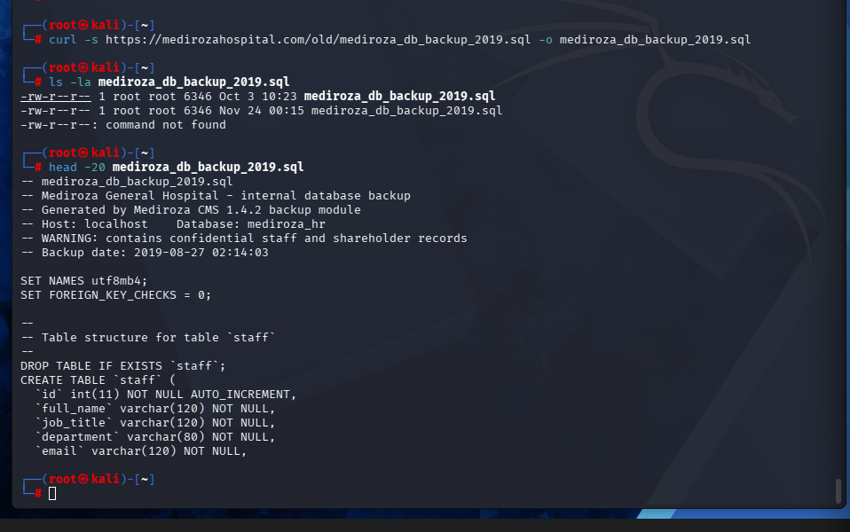
</p>

<p align="center">
  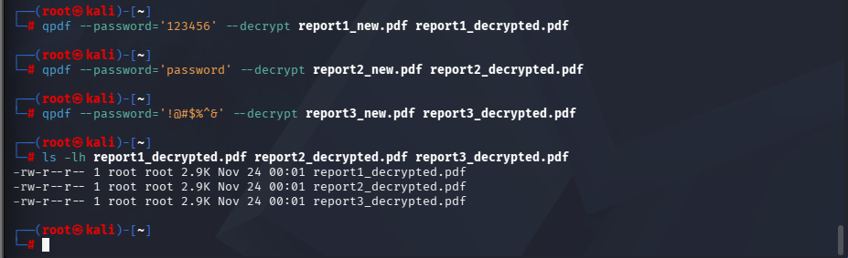
</p>

<p align="center">
  
</p>

<p align="center">
  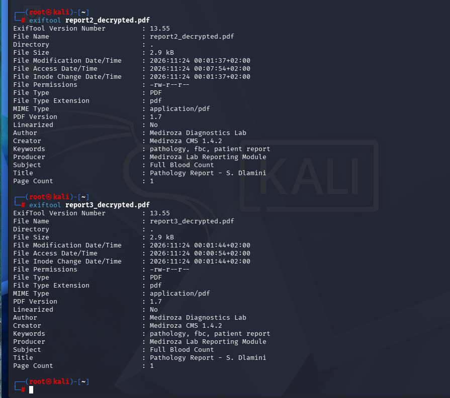
</p>

<p align="center">
  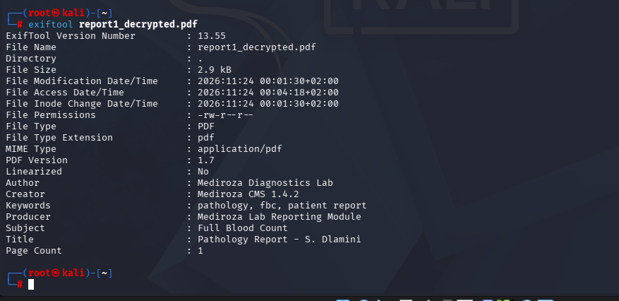
</p>

<p align="center">
  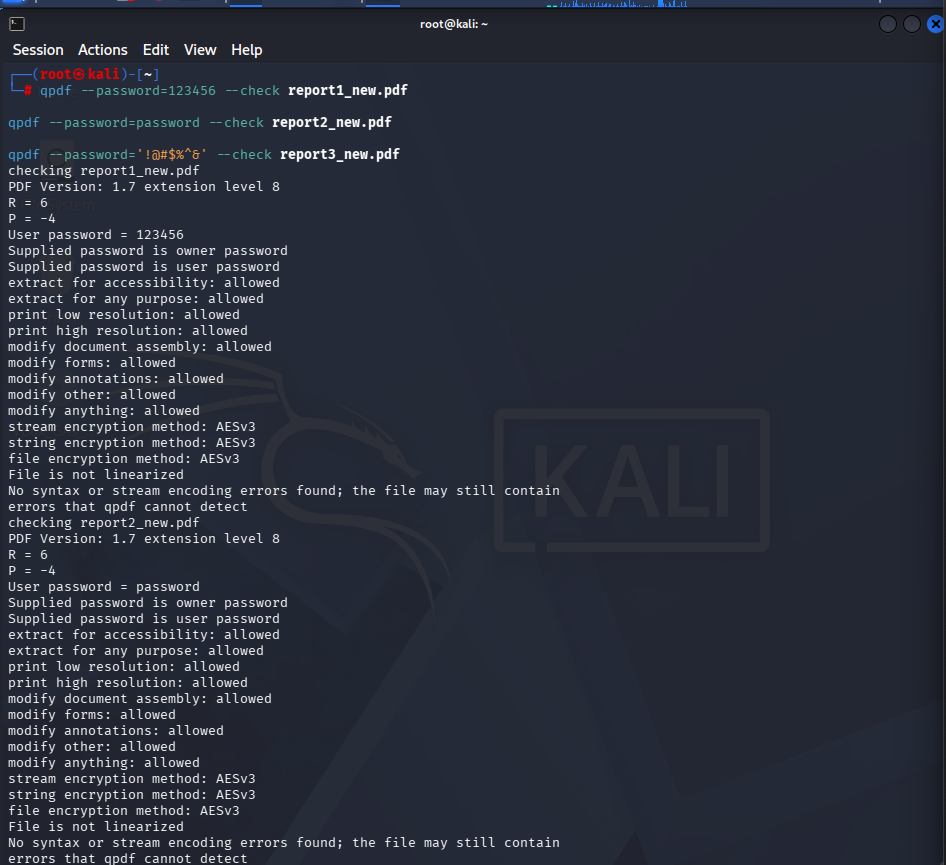
</p>

<p align="center">
  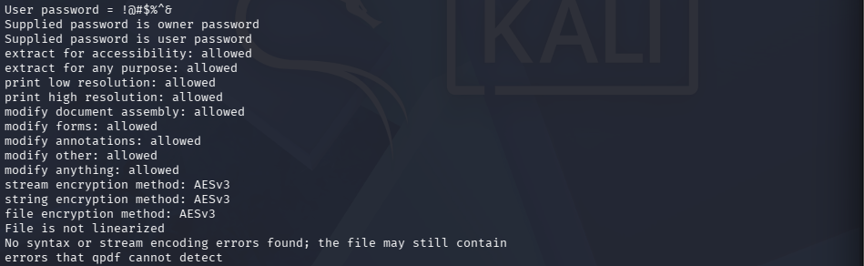
</p>

<p align="center">
  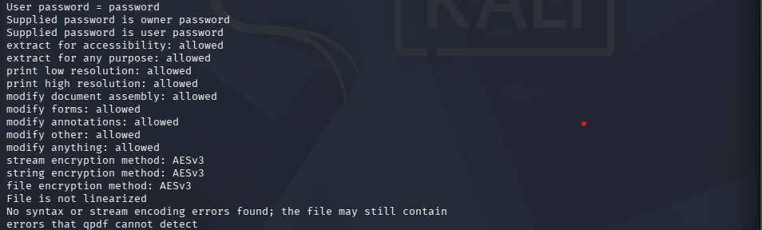
</p>

<p align="center">
  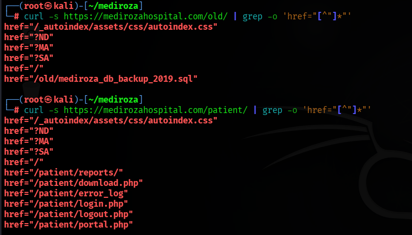
</p>

<p align="center">
  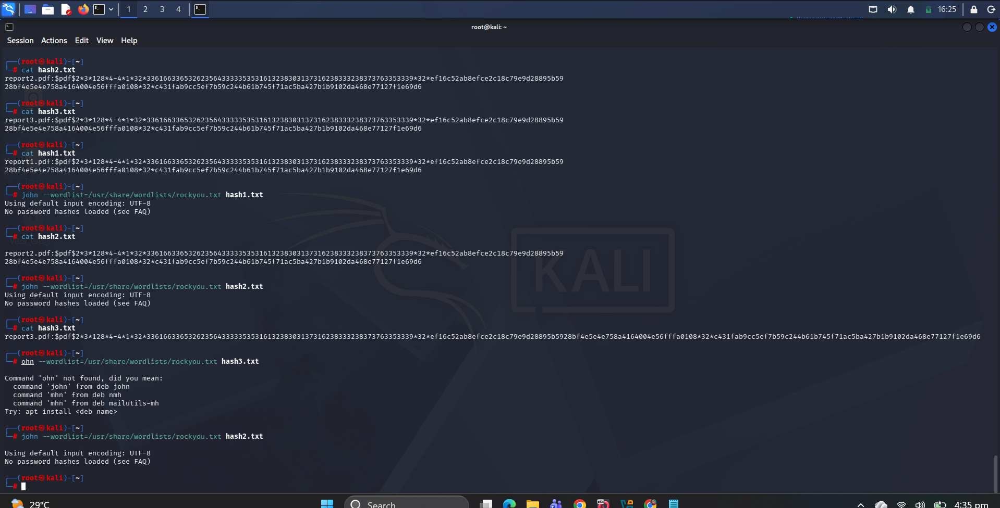
</p>

<p align="center">
  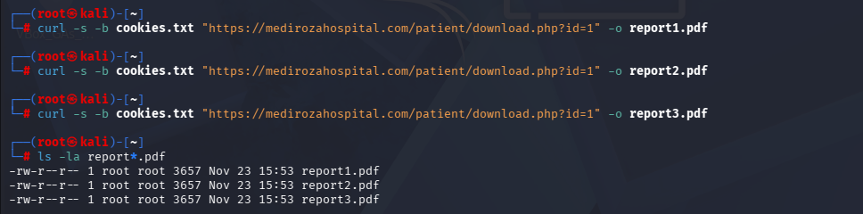
</p>

## Project Report
**[Download the Week 4 Project Report](https://github.com/mulengachiwele174-afk/Penetration-Testing/blob/4e728dcffe7ce09eb04ac4397553f3eb49d60389/Mediroza_Penetration_Test_Report.pdf)**

## About the Author

**Mulenga Chiwele**
Aspiring Security Analyst | Network Security

I am building hands-on skills in penetration testing, vulnerability assessment and secure reporting, with an emphasis on authorized scope and responsible disclosure.

- GitHub: [mulengachiwele174-afk](https://github.com/mulengachiwele174-afk)
- LinkedIn: [Mulenga Chiwele](https://www.linkedin.com/in/mulenga-chiwele-712a64365)
- Email: [Mulengachiwele174@gmail.com](mailto:Mulengachiwele174@gmail.com)

## Disclaimer

This repository documents an authorized, educational penetration test conducted under the Networkwalks training programme. It is published for defensive and learning purposes only. Client identity, personal data, credentials and sensitive records have been removed. Do not attempt these techniques against any system without explicit written permission from its owner.

## Copyright

© 2026 Mulenga Chiwele. All Rights Reserved.

This write-up, including its structure, analysis, wording and original diagrams, is the intellectual property of **Mulenga Chiwele**. It was produced as coursework for the Networkwalks Cybersecurity Internship.

You may read this material for learning purposes and link to it. You may not copy, reproduce, republish, translate or present it, in whole or in part, as your own work without prior written permission from the author. Quotations are permitted with clear attribution and a link back to this repository.

For permissions and enquiries: [Mulengachiwele174@gmail.com](mailto:Mulengachiwele174@gmail.com)

---

<div align="center">

### © 2026 Mulenga Chiwele · All Rights Reserved

This write-up is the original work of **Mulenga Chiwele** and is shared for educational purposes only. Please do not copy or republish it without permission.

<sub>Week 4 Black-Box Penetration Test and Vulnerability Assessment · 24 November 2026 · Document ID: `MC-WBPT-2026-1124`</sub>

<sub>Enquiries: [Mulengachiwele174@gmail.com](mailto:Mulengachiwele174@gmail.com)</sub>

</div>

<!--
Original work by Mulenga Chiwele (github.com/mulengachiwele174-afk)
Week 4 Black-Box Penetration Test and Vulnerability Assessment · Document ID: MC-WBPT-2026-1124
Educational use only. Unauthorized copying or republishing without credit is not permitted.
-->
